# ต้นเมเปิลบนโปรไฟล์ GitHub ของ KorawitJung

เอกสารออกแบบ วันที่ 2026-11-21 สถานะ: รออนุมัติ

## เป้าหมายและเหตุผล

ภาพนี้มีคนดูสองกลุ่ม คนที่เปิดหน้าโปรไฟล์ <https://github.com/KorawitJung> ต้องรู้สึกว่าสวยตั้งแต่แรกเห็น ส่วนเจ้าของโปรไฟล์ต้องนับดอกไม้บนต้นได้ตอนจบวัน และรู้ว่าวันนั้นพยายามไปเท่าไร

ฉากเป็น pixel art ของป่าฤดูใบไม้ร่วง มีลำธารสีฟ้าไหลลึกเข้าไปกลางป่า ต้นไม้สองฝั่งยิ่งไกลยิ่งเล็กลงและจางลง ต้นเมเปิลสีเหลืองทองอยู่หน้าสุดทางขวา ใต้ต้นมีม้านั่งสวนสาธารณะสีเขียวเข้ม ดอกสีแดงบนต้นเมเปิลมีจำนวนเท่ากับ contributions ของวันนี้ และอัปเดตทุกชั่วโมง

หน้าตาที่อนุมัติแล้วอยู่ใน [`2026-11-21-maple-mockup-v2.html`](2026-11-21-maple-mockup-v2.html) เปิดไฟล์นั้นในเบราว์เซอร์แล้วเลื่อนแถบ contributions เพื่อดูได้ ตัวจริงต้องออกมาเหมือนไฟล์นี้

## สิ่งที่ต้องได้ สิ่งที่ไม่ทำ และสิ่งที่ถือว่าล้มเหลว

ต้องได้:

- ภาพเคลื่อนไหวขึ้นบน README ของ repo `KorawitJung/KorawitJung` โดยแสดงเหนือปลาคาร์ปที่มีอยู่
- ดอกหนึ่งดอกเท่ากับหนึ่ง contribution ของวันนี้ตามเวลาไทย
- ภาพอัปเดตทุกชั่วโมง และเริ่มนับใหม่เมื่อขึ้นวันใหม่
- ใบไม้ร่วงจากต้นเมเปิลครั้งละ 5 ใบ ร่วงวนตลอดเวลา
- ดอกไม้ค่อยๆ บานทีละดอกทุกครั้งที่มีคนเปิดหน้าโปรไฟล์

ไม่ทำ:

- ไม่ทำเป็น Action สำเร็จรูปบน Marketplace
- ไม่ทำการนับแยกเอง จำนวนดอกเท่ากับตัวเลขในช่องวันนี้ของกราฟ contribution บนโปรไฟล์เสมอ ถ้าวันหลังเจ้าของเปิด "Include private contributions" งานใน repo ส่วนตัวก็จะถูกนับตามกราฟไปด้วย
- ไม่แสดงประวัติของวันก่อนหน้า
- ไม่ใช้สีภาษาหรือ streak มากำหนดหน้าตา
- ไม่ทำภาพแยกสำหรับธีมสว่างและธีมมืด เพราะฉากเป็นภาพทึบที่ใช้ได้ทั้งสองธีม

ถือว่าล้มเหลว แม้ระบบจะทำงานได้:

- ต้นไม้ดูโล่งหรือไม่สวยในวันที่ยังไม่มีดอก
- นับดอกไม่ได้ เช่น ดอกซ้อนทับกัน
- ประวัติ commit ของ branch `main` รกด้วย commit รายชั่วโมง
- workflow ของ koi พัง หรือปลาคาร์ปหายไป

## ข้อเท็จจริงและข้อจำกัด

ข้อมูลของ GitHub ที่ตรวจกับบัญชีจริงแล้วเมื่อ 2026-11-21:

- `contributionsCollection(from:, to:)` คืนข้อมูลเป็นรายวันทั้งวัน ไม่ได้ตัดตามชั่วโมง ตอนส่งช่วง `2026-11-20T17:00Z` ถึง `2026-11-21T16:59Z` ได้ทั้งวันที่ 20 (17 ครั้ง) และวันที่ 21 (2 ครั้ง) กลับมาเต็มวัน
- `commitContributionsByRepository` คืน `occurredAt` เป็น `T08:00:00Z` ทุกรายการ แปลว่า GitHub เก็บเป็นวันที่ ไม่ได้เก็บเวลา
- ตามเอกสาร GitHub วันที่ของ commit มาจากเขตเวลาใน author date ส่วน issue และ PR มาจากเขตเวลาของเบราว์เซอร์ เครื่องของเจ้าของตั้งเวลาไทย ข้อมูลรายวันจึงตรงกับวันตามเวลาไทย ข้อนี้อนุมานจากเอกสาร ยังไม่ได้ทดสอบตอนข้ามเที่ยงคืน
- `restrictedContributionsCount` เป็น 0 คือบัญชีนี้ไม่ได้เปิดให้นับงานใน repo ส่วนตัว

ข้อจำกัดของ GitHub README:

- README รัน JavaScript ไม่ได้ ภาพต้องเป็น SVG ที่ขยับด้วย CSS เท่านั้น ห้ามมี `<script>`
- GitHub แสดงรูปภายนอกผ่านพร็อกซีแคช และ `raw.githubusercontent.com` ส่ง `max-age=300` ดอกใหม่จึงอาจขึ้นช้าไปประมาณ 5 นาทีหลังจาก Action รันเสร็จ (อนุมาน)
- ม็อกอัปใช้ CSS custom property ต่อชิ้น (`--a`, `--b`, `--c`) และใช้ `offset-path` ทั้งสองอย่างนี้ยังไม่ได้ทดสอบว่าทำงานใน SVG ที่แสดงผ่านแท็ก `` บน GitHub ดูวิธีจัดการได้ในหัวข้อ "สิ่งที่ผู้สร้างตัดสินเอง"

การอยู่ร่วมกับ koi:

- `.github/workflows/koi.yml` รันวันละครั้งตอน 00:20 UTC และ push `koi/koi.gif` เข้า `main`
- workflow ใหม่ต้องไม่แตะ `main` และต้องไม่ใช้ concurrency group ชื่อ `koi`
- koi commit เข้า `main` ทุกวัน repo จึงมีความเคลื่อนไหวตลอด GitHub จะไม่ปิด workflow ตามเวลาเพราะไม่มีความเคลื่อนไหวครบ 60 วัน

## วิธีที่พิจารณา

| วิธี | ข้อดี | ข้อเสีย |
|---|---|---|
| **สคริปต์ Node ใน repo และ workflow รันทุกชั่วโมง (เลือก)** | ไม่มี dependency ยกโค้ดจากม็อกอัปมาได้เกือบทั้งหมด ไม่พึ่งบริการภายนอก | ดอกใหม่ขึ้นช้ากว่าจริงได้ถึงประมาณ 1 ชั่วโมง |
| ทำเป็น Action สำเร็จรูปแบบ git-koi | คนอื่นนำไปใช้ได้ | ต้องดูแลเวอร์ชัน release และเอกสาร ทั้งที่มีผู้ใช้คนเดียว |
| เซิร์ฟเวอร์วาดภาพทุกครั้งที่มีคนเปิดดู | ไม่ต้อง commit | ต้องมีโฮสต์และเก็บ token บนเซิร์ฟเวอร์ และพร็อกซีของ GitHub ยังแคชรูปอยู่ดี จึงไม่ได้สดกว่าจริง |

เลือกวิธีแรกเพราะมีชิ้นส่วนน้อยที่สุด ถ้าวันหลังอยากแชร์ให้คนอื่นใช้ ค่อยห่อสคริปต์เดิมเป็น Action ได้

## สิ่งที่ตัดสินแล้ว

### ไฟล์ใน repo

- `scripts/maple/scene.mjs` เป็นฟังก์ชันบริสุทธิ์ `renderScene(count)` ที่คืนค่า SVG เป็น string ไม่มี I/O และผลลัพธ์ต้องเหมือนเดิมทุกครั้งที่ใส่ค่าเดิม
- `scripts/maple/render.mjs` เป็นจุดเริ่มต้น ทำหน้าที่ดึงจำนวน contributions เรียก `renderScene` แล้วเขียนไฟล์ ถ้าส่ง `--count <n>` จะข้ามการดึงข้อมูล ใช้สำหรับดูตัวอย่างในเครื่อง
- `scripts/maple/scene.test.mjs` เป็นเทสต์ที่รันด้วย `node --test` ไม่ต้องลงอะไรเพิ่ม
- `.github/workflows/maple.yml` คือ workflow
- `README.md` เพิ่มภาพต้นเมเปิลไว้เหนือบล็อกปลาคาร์ปเดิม และไม่แก้บล็อกปลาคาร์ป

### ฉาก

- กริดขนาด 128 x 64 ช่อง ช่องละ 5 px ได้ `viewBox="0 0 640 320"` และใช้ `shape-rendering="crispEdges"`
- ฉากถูกกำหนดด้วยเลขสุ่มแบบมี seed (mulberry32) ใช้ seed 21 สำหรับฉาก และ seed 5 สำหรับตำแหน่งดอก ทุกครั้งที่รันจึงได้ต้นไม้หน้าตาเดิม สิ่งเดียวที่เปลี่ยนคือจำนวนดอก
- ชั้นภาพ จานสี พุ่มไม้ ม้านั่ง และเส้นขอบ ให้ยกจากม็อกอัป v2 มาตรงตัว
- โครงข้อมูลหลักคือกริดสีหนึ่งชั้น คู่กับกริดเจ้าของช่อง (`leaf`, `trunk`, `bench` หรือว่าง) เส้นขอบคำนวณจากกริดเจ้าของช่องในรอบเดียว ไม่ต้องเขียนเงื่อนไขแยกของแต่ละชิ้น
- รวมช่องสีเดียวกันที่อยู่ติดกันในแถวเดียวเป็น `<rect>` ยาวอันเดียว เพื่อให้ไฟล์เล็กลง

### ดอกไม้

- คำนวณตำแหน่งดอกบนพุ่มเมเปิลไว้ล่วงหน้าเป็นลำดับตายตัว ประมาณ 90 ตำแหน่ง แต่ละตำแหน่งห่างกันมากกว่า 3 ช่องแบบ Manhattan
- ถ้ามี `n` contributions ให้วาดดอกที่ตำแหน่ง `min(n, ความจุ)` แรก ดอกจึงงอกเพิ่มที่ตำแหน่งเดิมทุกชั่วโมง ไม่สลับที่
- ถ้า `n` เกินความจุ ต้นไม้จะบานเต็มต้นและหยุดเพิ่ม ไม่วาดดอกซ้อนกัน
- ดอกหนึ่งดอกเป็นรูปกากบาท 5 ช่อง กลีบสีแดง `#D7263D` เกสรสีเหลือง `#FFE08A`
- ดอกบานแบบเป็นขั้น `steps(3)` และค่อยๆ บานต่อกันทีละดอก ระยะห่างระหว่างดอกคือ `min(0.12s, 6s / n)` ดอกทั้งหมดจึงบานครบภายในประมาณ 6 วินาที

### ภาพเคลื่อนไหว

- ใบไม้ร่วงจากพุ่มเมเปิล 10 ใบ แบ่งเป็นสองชุด ชุดละ 5 ใบ ห่างกัน 3.5 วินาที รอบหนึ่งยาว 7 วินาที
- จุดน้ำกระเพื่อมสีขาวอมฟ้ากะพริบอยู่บนผิวน้ำประมาณ 8% ของช่องน้ำ
- ใบไม้ 2 ใบลอยตามลำธารจากด้านไกลมาด้านหน้า รอบละ 16 วินาที

### การดึงข้อมูล

- `render.mjs` เรียก `https://api.github.com/graphql` ด้วย `fetch` ของ Node และใช้ token จากตัวแปร `GITHUB_TOKEN`
- คำว่าวันนี้หมายถึงวันที่ปัจจุบันในเขตเวลา `Asia/Bangkok`
- query คือ `contributionsCollection(from: <วันนี้>T00:00:00+07:00, to: <วันนี้>T23:59:59+07:00)` แล้วเลือก `contributionCount` ของวันใน `contributionCalendar` ที่ `date` ตรงกับวันนี้ ถ้าไม่มีวันนั้นให้นับเป็น 0
- ใช้ `GITHUB_TOKEN` ที่ Actions สร้างให้ ไม่ใช้ Personal Access Token git-koi อ่านข้อมูลสาธารณะชุดเดียวกันด้วย token นี้ จึงน่าจะใช้ได้ (อนุมาน) ถ้าการรันครั้งแรกพิสูจน์ว่าอ่านไม่ได้ ให้หยุดและถามเจ้าของ ห้ามสร้างหรือขอ token เอง
- ถ้า API ล้มเหลวหรือตอบข้อมูลที่ไม่ถูกรูปแบบ ให้ workflow จบด้วยสถานะล้มเหลว และไม่ทับภาพเดิม

### Workflow และการเผยแพร่

- trigger คือ `schedule` สามรายการ ได้แก่ `cron "17 * * * *"` สำหรับรันทุกชั่วโมง และ `cron "30 16 * * *"` กับ `cron "50 16 * * *"` ซึ่งตรงกับ 23:30 และ 23:50 เวลาไทย สองรายการหลังช่วยให้ภาพใกล้ยอดรวมของวันที่สุดก่อนขึ้นวันใหม่ นอกจากนี้มี `workflow_dispatch` และ `push` เฉพาะตอนไฟล์ใน `scripts/maple/**` หรือ `.github/workflows/maple.yml` เปลี่ยน
- "วันนี้" คำนวณจากเวลาตอนที่ workflow รันจริง GitHub มักเริ่มรอบที่ตั้งเวลาไว้ช้ากว่ากำหนด 10 ถึง 60 นาที ถ้ารอบ 23:50 ไปเริ่มหลังเที่ยงคืน ภาพจะเป็นของวันใหม่ ข้อจำกัดนี้ยอมรับได้ งานที่ทำในช่วงไม่กี่นาทีสุดท้ายของวันจึงอาจไม่ขึ้นบนต้น แต่ยังถูกนับในกราฟ contribution ตามปกติ
- ตั้ง `permissions: contents: write` และ `concurrency: maple`
- ภาพไปอยู่ใน branch `output` ซึ่งมีไฟล์เดียวคือ `maple.svg` และมี commit เดียว ทุกครั้งที่ภาพเปลี่ยน workflow จะสร้าง orphan commit ใหม่ แล้ว force-push ทับ branch `output`
- ถ้า `maple.svg` ที่เพิ่งสร้างตรงกับไฟล์บน branch `output` ทุกไบต์ workflow จะไม่ push การรันซ้ำจึงได้ผลเหมือนเดิม
- commit ใช้ชื่อ `github-actions[bot]` แบบเดียวกับ koi commit ของ bot ไม่ถูกนับเป็น contribution ของเจ้าของ ดอกจึงไม่งอกเพิ่มจาก commit ของตัวเอง (อนุมาน)

### README

เพิ่มบล็อกนี้ใต้หัวข้อ `# Hi, I'm Korawit 👋` และเหนือบล็อกปลาคาร์ป:

```html
<p align="center">
  
</p>
```

## การตรวจสอบ

1. `node --test scripts/maple` ผ่านทุกข้อ เทสต์ต้องตรวจสามอย่าง
   - ใส่ค่าเดิมแล้วได้ SVG เดิมทุกไบต์
   - SVG มีกลุ่มดอกไม้ `min(n, ความจุ)` กลุ่ม เมื่อ `n` เป็น 0, 1, 17, ความจุ และความจุบวก 10
   - ไม่มี `<script>` อยู่ใน SVG
2. `node scripts/maple/render.mjs --count 17 --out preview.svg` แล้วเปิดไฟล์ผ่านแท็ก `` ในเบราว์เซอร์ หน้าตาต้องตรงกับม็อกอัป และทุกภาพเคลื่อนไหวต้องขยับ
3. รัน workflow ด้วย `workflow_dispatch` แล้วตรวจว่า branch `output` มี `maple.svg` และจำนวนดอกตรงกับ contributions ของวันนี้จาก API
4. เปิด <https://github.com/KorawitJung> ทั้งในธีมสว่างและธีมมืด ต้องเห็นต้นเมเปิลขยับอยู่เหนือปลาคาร์ป และปลาคาร์ปยังแสดงอยู่

## สิ่งที่ผู้สร้างตัดสินเอง

- วิธีทำภาพเคลื่อนไหวต่อชิ้น ถ้า CSS custom property หรือ `offset-path` ไม่ทำงานใน SVG ที่แสดงผ่าน `` ให้เปลี่ยนเป็น keyframe แยกของแต่ละชิ้น หรือเปลี่ยนเป็นจุดผ่านชุดหนึ่ง ผลที่ได้ต้องดูเหมือนเดิม
- การปรับสีเล็กน้อยเมื่อดูในขนาดจริงบน GitHub ห้ามเปลี่ยนโทนหลักของแต่ละชิ้น คือต้นเหลืองทอง ม้านั่งเขียวเข้ม น้ำฟ้า และดอกแดง
- โครงสร้างภายในของ `scene.mjs` และวิธีเขียนเทสต์
- ความจุดอกที่แน่นอน ประมาณ 90 ตำแหน่ง ขึ้นกับจำนวนช่องที่วางได้จริง
